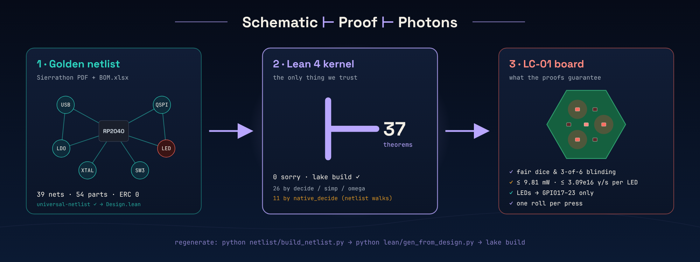
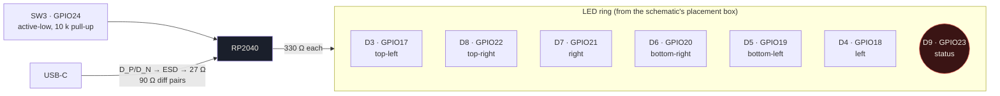
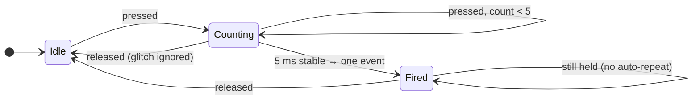
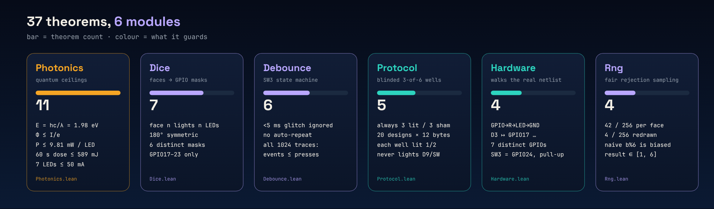

<p align="center"></p>

<p align="center"><b>LeanChip turns the Sierrathon RP2040 board into a photon-dose controller for quantum-biology experiments, where every claim about the light is a Lean 4 theorem.</b><br>
Same schematic, same BOM, zero extra parts. The proofs are computed from the real netlist.</p>

<p align="center">


</p>

# LeanChip: a verified photon-dose controller

*Built for Sierrathon 2026: design a manufacturable, cost-effective board from the provided RP2040 schematic and BOM.*

Quantum-biology experiments (red light on cytochrome c oxidase, photobiomodulation of cells, photosynthesis, light-gated behaviour) all hinge on two things:
**knowing how many photons hit each sample**, and **randomly, blindly choosing which samples get light**. LeanChip does both with the parts already on the board, and proves it.

| | The hardware | The physics | The proof |
|:-:|---|---|---|
| 🔴 | 7 × QBLP601-R5 red LEDs (625 nm) in a hexagon: 6 wells + 1 status | each photon is one electron–hole recombination, E = hc/λ = **1.98 eV** | `photon_energy`, `bandgap_consistent` |
| ⚡ | 330 Ω resistors on GPIO17–23, 3.3 V LDO | ≤ 1 photon per electron, so **Φ ≤ I/e** and **P ≤ I·E/e** | `photon_flux_ceiling`, `optical_power_ceiling` |
| ⏱️ | 12 MHz crystal | exposure time error ≤ 50 ppm | `dose_60s`, `timing_10min` |
| 🎲 | RP2040 ring-oscillator randomness, SW3 button | rejection sampling → **exactly uniform** | `roll_uniform`, `uniform_over_designs` |
| 🧫 | the 6-LED ring | blinded **3 treated / 3 sham** every run | `always_balanced`, `each_well_half` |

## Pipeline

<p align="center"></p>

1. **Golden netlist.** The schematic PDF was transcribed into [`netlist/Sierrathon.netlist.json`](netlist/Sierrathon.netlist.json) (the [Universal Netlist](https://github.com/IntelligentElectron/universal-netlist) open format, SHA-256 checked). `universal-netlist run_erc` passes all 8 rules.
2. **Lean data.** [`lean/gen_from_design.py`](lean/gen_from_design.py) turns the netlist and BOM into [`Design.lean`](lean/Sierrathon/Design.lean). Nothing about the circuit is retyped by hand.
3. **Lean kernel.** Firmware tables are *computed* by walking that netlist (GPIO → resistor → LED → GND), then proved correct.

## The board

The schematic's own **"LED Placement"** box puts 6 LEDs around a centre one, which is a hexagon. So LeanChip is a hexagonal board: six sample sites around a status light.



Every GPIO number above was **recovered from the netlist by Lean** (`led_gpio_map`), not copied from the schematic.

### Modes (one button)

<table>
<tr>
<td width="50%" valign="top">

**🧫 Blinded dose run.** Press SW3: firmware draws one of the 20 balanced designs, lights 3 wells for a crystal-timed exposure, and leaves 3 as sham. D9 glows while the exposure runs.

```
  ●   ○        lit  = treated
○   ◉   ●      ○    = sham
  ●   ○        ◉    = running
```

</td>
<td width="50%" valign="top">

**🎲 Dice.** The same ring makes a die. The faces Lean renders on the real layout:

```
face 1   face 2   face 3   face 6
○   ○    ●   ○    ●   ○    ●   ●
○ ● ○    ○ ○ ○    ○ ● ○    ● ○ ●
○   ○    ○   ●    ○   ●    ●   ●
```

</td>
</tr>
</table>



*The SW3 debouncer, exactly as defined in [`Debounce.lean`](lean/Sierrathon/Debounce.lean). Lean checks all 1,024 possible 10 ms button traces and confirms it never counts more events than presses.*

## Proofs

<p align="center"></p>

<details>
<summary><b>All 37 theorems</b></summary>

| Module | Theorem | What it says |
|---|---|---|
| **Photonics** | `photon_energy` | a 625 nm photon carries 1,983,747 µeV |
| | `bandgap_consistent` | e·V_f ≥ E_photon (the LED colour is physically consistent) |
| | `led_current_max` | worst-case LED current = 4.945 mA |
| | `default_drive_insufficient` | RP2040's default 4 mA pad drive is **not** enough… |
| | `drive_8mA_sufficient` | …so firmware sets 8 mA, which is |
| | `all_leds_within_budget` | all 7 LEDs on ≤ 50 mA GPIO budget |
| | `photon_flux_ceiling` | ≤ 3.09 × 10¹⁶ photons/s per LED |
| | `optical_power_ceiling` | ≤ 9.81 mW optical per LED |
| | `array_power_ceiling` | ≤ 68.7 mW for the whole array |
| | `dose_60s` | a 60 s exposure delivers ≤ 589 mJ per LED |
| | `timing_10min` | crystal error over 10 min ≤ 30 ms |
| **Dice** | `pip_count` | face n has n pips |
| | `pips_on_leds` | every pip lands on a real LED |
| | `faces_point_symmetric` | every face looks the same upside down |
| | `mask_lights_n_leds` | face n lights exactly n LEDs on the board |
| | `masks_distinct` | the 6 faces are 6 different patterns |
| | `masks_only_touch_led_pins` | firmware only drives GPIO17–23 |
| | `mask_table` | the exact table the firmware ships |
| **Debounce** | `event_needs_press` | a roll only fires on a pressed sample |
| | `latched_silent` | holding the button never auto-repeats |
| | `release_resets` | releasing clears the state |
| | `short_glitch_ignored` | presses shorter than 5 ms never fire |
| | `long_hold_fires_once` | a 1 s hold fires exactly once |
| | `never_double_counts` | over all 1,024 traces, events ≤ presses |
| **Protocol** | `twenty_designs` | there are C(6,3) = 20 balanced designs |
| | `always_balanced` | every design treats exactly 3, shams exactly 3 |
| | `uniform_over_designs` | each design has exactly 12 of 256 byte values |
| | `each_well_half` | each well is treated in exactly half the designs |
| | `design_masks_safe` | a design never lights D9 or touches the button pin |
| **Hardware** | `every_led_driven_and_grounded` | GPIO → R → LED → GND for all 7 LEDs |
| | `led_gpio_map` | the exact LED ↦ GPIO wiring |
| | `led_gpios_distinct` | 7 LEDs on 7 different GPIOs |
| | `button_wiring` | SW3 is GPIO24, active-low, pulled up, not an LED pin |
| **Rng** | `roll_in_range` | every roll is in 1..6 (∀ b, by `omega`) |
| | `roll_uniform` | each face has exactly 42 of 256 bytes |
| | `reject_count` | only 4 of 256 bytes are redrawn |
| | `naive_is_biased` | the naive `b % 6` really is biased |

</details>

### What to trust, and how much

> [!IMPORTANT]
> **Assumptions are named, not hidden.** Every input that isn't a physical constant is a named `def` in [`Photonics.lean`](lean/Sierrathon/Photonics.lean), marked `ASSUMPTION` in a comment: LED V<sub>f</sub> min/typ, LDO worst-case high, RP2040 GPIO budget, crystal ppm. Change a value and `lake build` tells you which guarantees still hold.

> [!NOTE]
> **26 proofs** are checked by the Lean kernel alone (`decide`, `simp`, `omega`, `rfl`). **11** use `native_decide`, which also trusts the compiler; these are the ones that walk the netlist strings. Moving them to kernel-only `decide` is on the roadmap.

The power ceilings are **upper bounds that hold for any LED efficiency**. They make a safe "never more than" dose. A *delivered* dose (for J/cm²) still needs a one-time calibration with a photodiode at your sample distance.

## Hardware spec

<table>
<tr><td valign="top">

| Stack-up (4-layer, 62 mil) | |
|---|---|
| Material | FR-4, Isola 370HR |
| L1 / L4 | signal, 1 oz finished |
| L2 / L3 | power planes |
| SE 50 Ω | 7.6 mil (L1 ref L2, L4 ref L3) |
| **Diff 90 Ω** | **5.0 / 4.0 mil** w/s |

</td><td valign="top">

| Rules | |
|---|---|
| Min trace / space | 6 / 6 mil |
| Min drill | 8 mil, through-hole |
| Drill-to-copper | 8 mil |
| Class | IPC Class 2 |
| Max current | 1 A |
| Mask / silk | green / white |

</td></tr>
</table>

**90 Ω pairs:** `USB_P/USB_N`, `USBR_P/USBR_N`, `D_P/D_N`

**Issues found in the provided docs:**
- BOM line 5 says **Qty 8** for LEDs but lists **7** refdes (D3–D9). The schematic has 7.
- The stack-up drawing shows **0.5 oz** inner copper. The written spec says **1 oz**.

<details>
<summary><b>Bill of materials (21 lines)</b></summary>

| RefDes | Qty | Value | Manufacturer | MPN |
|---|:-:|---|---|---|
| C1, C2 | 2 | 1 µF 0603 | Murata | GCM188R71C105KA64D |
| C3, C5, C14, C17 | 4 | 2.2 µF 0805 | Murata | GCM21BR71C225KA64L |
| C4, C8–C13, C15, C16 | 9 | 0.1 µF 0402 | Murata | GCM155R71C104KA55D |
| C6, C7 | 2 | 15 pF 0402 | Murata | GCM1555C1H150JA16D |
| D3–D9 | 7 | red LED 0603 | QT Brightek | QBLP601-R5 |
| J1 | 1 | USB-C | Same Sky | UJ20-C-H-G-SMT-TR |
| MH1–MH4 | 4 | M4 hole | | DNI |
| R1, R2 | 2 | 5.1 k | YAGEO | RC0402JR-075K1L |
| R4 | 1 | 200 Ω 0603 | YAGEO | RC0603JR-07200RL |
| R5, R6 | 2 | 27 Ω | YAGEO | RC0402FR-0727RL |
| R7, R8 | 2 | 1 k | YAGEO | RC0402FR-071KL |
| R9, R10, R19 | 3 | 10 k | YAGEO | RC0402JR-0710KL |
| R12–R18 | 7 | 330 Ω | YAGEO | AF0402JR-07330RL |
| SW1, SW2 | 2 | BOOT / RESET | C&K | PTS526SM15SMTR2 LFS |
| SW3 | 1 | user switch | C&K | D6R90 F2 LFS |
| U1 | 1 | MCU | Raspberry Pi | RP2040 (SC0914(13)) |
| U2 | 1 | 3.3 V LDO | Diodes Inc. | AP2112K-3.3TRG1 |
| U3 | 1 | 128 Mbit flash | Winbond | W25Q128JVSIQ TR |
| U4 | 1 | USB ESD | ST | USBLC6-2SC6 |
| Y1 | 1 | 12 MHz | Abracon | ABM8-272-T3 |

</details>

## Repository

```
├── lean/                     Lean 4 project (lake build)
│   ├── gen_from_design.py    netlist + BOM  →  Sierrathon/Design.lean
│   └── Sierrathon/           Hardware · Dice · Rng · Debounce · Photonics · Protocol
├── netlist/                  golden netlist (Universal Netlist v3) + its builder
├── altium/                   Altium .SchLib / .PcbLib / .LibPkg, written with altium-designer-mcp
└── assets/                   banner and diagrams (SVG sources + PNG)
```

## Run it

```bash
cd lean && lake build
```

```bash
lake exe sierrathon
```

`lake build` checks every proof. `lake exe sierrathon` prints the dice faces on the real LED layout. Lean 4.15.0 is pinned in `lean/lean-toolchain`.

To re-check the netlist:

```bash
npm install -g @intelligentelectron/universal-netlist
```

```bash
universal-netlist run_erc netlist/Sierrathon.netlist.json
```

## Status

- [x] Golden netlist from the schematic: ERC clean
- [x] 37 Lean theorems, 0 `sorry`
- [x] Altium library: 18 of 21 parts with footprints (IPC-7351 land patterns)
- [ ] Footprints for SW1/SW2 (PTS526), SW3 (D6R90) and J1 (UJ20-C-H-G-SMT) from the manufacturer land patterns
- [ ] Schematic capture and hexagonal PCB layout in CAD, with the rules above and DRC
- [ ] RP2040 firmware (pico-sdk) built from the Lean-generated tables
- [ ] Photodiode calibration for delivered dose
