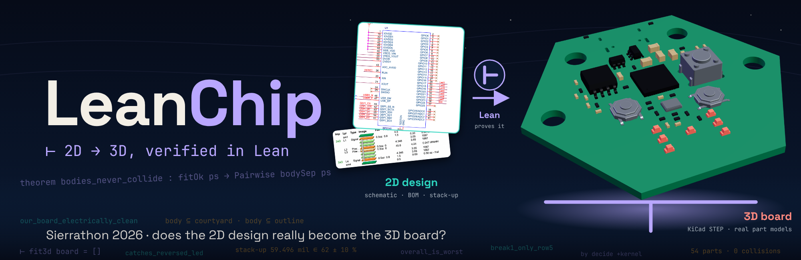
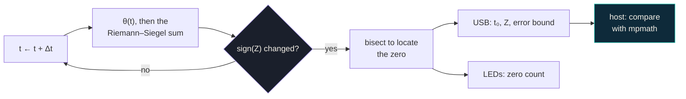
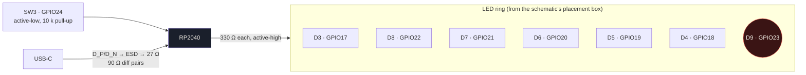
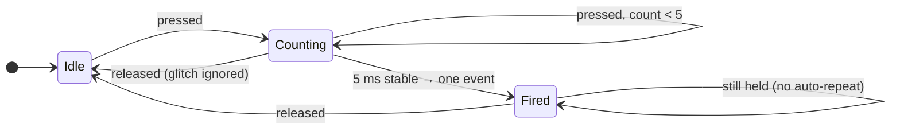

<p align="center"></p>

<p align="center"><b>LeanChip turns the Sierrathon RP2040 board into a Riemann zeta zero-hunter, and uses Lean 4 to check the math around it.</b><br>
Same schematic, same BOM, zero extra parts. It does <i>not</i> prove the Riemann Hypothesis, and this README is explicit about what is proven, what is only tested, and what is still open.</p>

<p align="center">


</p>

# LeanChip: a zeta zero-hunter on the Sierrathon board

*Built for Sierrathon 2026: design a manufacturable, cost-effective board from the provided RP2040 schematic and BOM.*

## The question

The Riemann zeta function ζ(s) = Σ n<sup>−s</sup> has "trivial" zeros at −2, −4, −6, …. Every other zero found so far sits on the **critical line Re(s) = ½**. The Riemann Hypothesis says they *all* do. It has been open since 1859. Mathlib states it exactly like this ([`Mathlib/NumberTheory/LSeries/RiemannZeta.lean`](https://github.com/leanprover-community/mathlib4/blob/v4.15.0/Mathlib/NumberTheory/LSeries/RiemannZeta.lean)):

```lean
def RiemannHypothesis : Prop :=
  ∀ (s : ℂ) (_ : riemannZeta s = 0) (_ : ¬∃ n : ℕ, s = -2 * (n + 1)) (_ : s ≠ 1), s.re = 1 / 2
```

## What this project claims, and what it doesn't

| | Status |
|---|---|
| ✅ **Proven in Lean** | 37 theorems about the board itself: the real netlist's LED and button wiring, a fair random-number sampler, a glitch-proof button debouncer, LED drive limits |
| 🔧 **In progress** | Lean lemmas over Mathlib's ζ: "a sign change of Z(t) means a zero on the critical line", ζ(s) ≠ 0 for Re(s) ≥ 1, the trivial zeros |
| 🔧 **In progress** | RP2040 firmware that computes Hardy's Z(t) with the Riemann–Siegel formula and finds zeros by sign changes |
| 🧪 **Tested, not proven** | Firmware zero locations will be *checked against* high-precision references (mpmath). That is numerical evidence, not a formal proof of the firmware |
| ❌ **Not claimed** | A proof of RH. Finding zeros on the line is evidence, never a proof: RH is already verified numerically far beyond anything a microcontroller can reach (Platt & Trudgian, up to height 3·10¹²) |

## Pipeline

<p align="center"></p>

1. **Golden netlist.** The schematic PDF was transcribed into [`netlist/Sierrathon.netlist.json`](netlist/Sierrathon.netlist.json) (the [Universal Netlist](https://github.com/IntelligentElectron/universal-netlist) open format, SHA-256 checked). `universal-netlist run_erc` passes all 8 rules.
2. **Lean data.** [`lean/gen_from_design.py`](lean/gen_from_design.py) turns the netlist and BOM into [`Design.lean`](lean/Sierrathon/Design.lean). Nothing about the circuit is retyped by hand.
3. **Lean kernel.** Board facts are *computed* by walking that netlist (GPIO → resistor → LED → GND), then proved.
4. **Zero-hunter** *(in progress).* The RP2040 evaluates Z(t), streams it over USB, and lights LEDs as zeros are found. The host re-checks every reported zero.

## How the zero hunt works

Hardy's function turns ζ on the critical line into a **real-valued** function:

$$Z(t) = e^{i\theta(t)}\,\zeta\left(\tfrac12 + it\right), \qquad \theta(t) \approx \frac{t}{2}\log\frac{t}{2\pi} - \frac{t}{2} - \frac{\pi}{8} + \frac{1}{48t}$$

Because |Z(t)| = |ζ(½ + it)| and Z is continuous and real, **every sign change of Z is a zero of ζ exactly on the critical line** (the intermediate value theorem). The Riemann–Siegel formula computes Z(t) with only about √(t/2π) terms, which is cheap enough for a microcontroller:

$$Z(t) = 2\sum_{n=1}^{N} \frac{\cos(\theta(t) - t\log n)}{\sqrt{n}} + R(t), \qquad N = \left\lfloor \sqrt{t/2\pi} \right\rfloor$$



The first zeros it should find (Im ρ, from mpmath at 20 digits):

| n | 1 | 2 | 3 | 4 | 5 | 6 | 7 | 8 | 9 | 10 |
|---|---|---|---|---|---|---|---|---|---|---|
| t | 14.1347 | 21.0220 | 25.0109 | 30.4249 | 32.9351 | 37.5862 | 40.9187 | 43.3271 | 48.0052 | 49.7738 |

## The board

The schematic's own **"LED Placement"** box puts 6 LEDs around a centre one, so LeanChip is a hexagonal board. Every GPIO number below was **recovered from the netlist by Lean** (`led_gpio_map`), not copied from the schematic.



**SW3** will start and pause the scan. It goes through the debouncer below, which is proved in [`Debounce.lean`](lean/Sierrathon/Debounce.lean): Lean checks all 1,024 possible 10 ms button traces and confirms it never counts more events than presses.



## Proofs

<p align="center"></p>

<details>
<summary><b>The 25 board theorems ZetaChip builds on</b></summary>

| Module | Theorem | What it says |
|---|---|---|
| **Hardware** | `every_led_driven_and_grounded` | GPIO → R → LED → GND for all 7 LEDs |
| | `led_gpio_map` | the exact LED ↦ GPIO wiring |
| | `led_gpios_distinct` | 7 LEDs on 7 different GPIOs |
| | `button_wiring` | SW3 is GPIO24, active-low, pulled up, not an LED pin |
| **Debounce** | `event_needs_press` | an event only fires on a pressed sample |
| | `latched_silent` | holding the button never auto-repeats |
| | `release_resets` | releasing clears the state |
| | `short_glitch_ignored` | presses shorter than 5 ms never fire |
| | `long_hold_fires_once` | a 1 s hold fires exactly once |
| | `never_double_counts` | over all 1,024 traces, events ≤ presses |
| **Electrical** | `led_current_max` | worst-case LED current = 4.945 mA |
| | `default_drive_insufficient` | RP2040's default 4 mA pad drive is **not** enough… |
| | `drive_8mA_sufficient` | …so firmware sets 8 mA |
| | `all_leds_within_budget` | all 7 LEDs on ≤ 50 mA GPIO budget |
| **Dice** | `pip_count` … `mask_table` | 7 theorems: LED patterns light exactly the intended LEDs, only on GPIO17–23 |
| **Rng** | `roll_in_range`, `roll_uniform`, `reject_count`, `naive_is_biased` | rejection sampling is exactly uniform; naive `b % 6` is biased |

The other 12 theorems (photon ceilings and 3-of-6 blinding in `Photonics.lean` and `Protocol.lean`) come from the earlier quantum-biology iteration. They still compile but ZetaChip doesn't use them.

</details>

### Zeta lemmas (next)

These build on results Mathlib **already proves**, so nothing about RH is assumed:

| Mathlib result | What it gives the zero-hunter |
|---|---|
| `riemannZeta_neg_two_mul_nat_add_one` | the trivial zeros ζ(−2(n+1)) = 0 |
| `riemannZeta_ne_zero_of_one_lt_re` | no zeros with Re(s) > 1 |
| `riemannZeta_ne_zero_of_one_le_re` | no zeros on Re(s) = 1 either, so every non-trivial zero lies in the open strip 0 < Re(s) < 1 |
| intermediate value theorem | a continuous real Z with Z(a)·Z(b) < 0 has a zero in (a, b) |

### What to trust, and how much

> [!IMPORTANT]
> **Assumptions are named, not hidden.** Electrical inputs that aren't physical constants (LED V<sub>f</sub>, LDO worst case, GPIO budget) are named `def`s marked `ASSUMPTION` in [`Photonics.lean`](lean/Sierrathon/Photonics.lean). Change one and `lake build` tells you which guarantees still hold.

> [!NOTE]
> **26 proofs** are checked by the Lean kernel alone (`decide`, `simp`, `omega`, `rfl`). **11** use `native_decide`, which also trusts the compiler; these are the ones that walk the netlist strings. Moving them to kernel-only `decide` is on the roadmap.

## Hardware spec

<table>
<tr><td valign="top">

| Stack-up (4-layer, 62 mil) | |
|---|---|
| Material | FR-4, Isola 370HR |
| L1 / L4 | signal, 1 oz finished |
| L2 / L3 | power planes |
| SE 50 Ω | 7.6 mil (L1 ref L2, L4 ref L3) |
| **Diff 90 Ω** | **5.0 / 4.0 mil** w/s |

</td><td valign="top">

| Rules | |
|---|---|
| Min trace / space | 6 / 6 mil |
| Min drill | 8 mil, through-hole |
| Drill-to-copper | 8 mil |
| Class | IPC Class 2 |
| Max current | 1 A |
| Mask / silk | green / white |

</td></tr>
</table>

**90 Ω pairs:** `USB_P/USB_N`, `USBR_P/USBR_N`, `D_P/D_N`

**Layout plan** *(in progress)*: a hexagonal 4-layer board with components packed as tightly as the 6 mil rules allow, plus a **thermal model** of the packed board (LDO, RP2040 and LEDs as heat sources) to check that the density stays cool.

**Issues found in the provided docs:**
- BOM line 5 says **Qty 8** for LEDs but lists **7** refdes (D3–D9). The schematic has 7.
- The stack-up drawing shows **0.5 oz** inner copper. The written spec says **1 oz**.

<details>
<summary><b>Bill of materials (21 lines)</b></summary>

| RefDes | Qty | Value | Manufacturer | MPN |
|---|:-:|---|---|---|
| C1, C2 | 2 | 1 µF 0603 | Murata | GCM188R71C105KA64D |
| C3, C5, C14, C17 | 4 | 2.2 µF 0805 | Murata | GCM21BR71C225KA64L |
| C4, C8–C13, C15, C16 | 9 | 0.1 µF 0402 | Murata | GCM155R71C104KA55D |
| C6, C7 | 2 | 15 pF 0402 | Murata | GCM1555C1H150JA16D |
| D3–D9 | 7 | red LED 0603 | QT Brightek | QBLP601-R5 |
| J1 | 1 | USB-C | Same Sky | UJ20-C-H-G-SMT-TR |
| MH1–MH4 | 4 | M4 hole | | DNI |
| R1, R2 | 2 | 5.1 k | YAGEO | RC0402JR-075K1L |
| R4 | 1 | 200 Ω 0603 | YAGEO | RC0603JR-07200RL |
| R5, R6 | 2 | 27 Ω | YAGEO | RC0402FR-0727RL |
| R7, R8 | 2 | 1 k | YAGEO | RC0402FR-071KL |
| R9, R10, R19 | 3 | 10 k | YAGEO | RC0402JR-0710KL |
| R12–R18 | 7 | 330 Ω | YAGEO | AF0402JR-07330RL |
| SW1, SW2 | 2 | BOOT / RESET | C&K | PTS526SM15SMTR2 LFS |
| SW3 | 1 | user switch | C&K | D6R90 F2 LFS |
| U1 | 1 | MCU | Raspberry Pi | RP2040 (SC0914(13)) |
| U2 | 1 | 3.3 V LDO | Diodes Inc. | AP2112K-3.3TRG1 |
| U3 | 1 | 128 Mbit flash | Winbond | W25Q128JVSIQ TR |
| U4 | 1 | USB ESD | ST | USBLC6-2SC6 |
| Y1 | 1 | 12 MHz | Abracon | ABM8-272-T3 |

</details>

## Repository

```
├── lean/                     Lean 4 project (lake build)
│   ├── gen_from_design.py    netlist + BOM  →  Sierrathon/Design.lean
│   └── Sierrathon/           Hardware · Debounce · Rng · Dice · Photonics · Protocol
├── netlist/                  golden netlist (Universal Netlist v3) + its builder
├── altium/                   Altium .SchLib / .PcbLib / .LibPkg, written with altium-designer-mcp
└── assets/                   banner and diagrams (SVG sources + PNG)
```

## Run it

```bash
cd lean && lake build
```

`lake build` checks every proof. Lean 4.15.0 is pinned in `lean/lean-toolchain`.

To re-check the netlist:

```bash
npm install -g @intelligentelectron/universal-netlist
```

```bash
universal-netlist run_erc netlist/Sierrathon.netlist.json
```

## Status

- [x] Golden netlist from the schematic: ERC clean
- [x] 37 Lean board theorems, 0 `sorry`
- [x] Altium library: 18 of 21 parts with footprints (IPC-7351 land patterns)
- [ ] Zeta lemmas over Mathlib (sign change ⇒ critical-line zero, zero-free region Re(s) ≥ 1)
- [ ] RP2040 zero-hunter firmware (pico-sdk): Riemann–Siegel Z(t), USB stream, LED zero counter
- [ ] Host verification against mpmath: PASS / FAIL / NOT_TESTED per zero
- [ ] Compact hexagonal 4-layer PCB, DRC, per-layer renders, thermal model
- [ ] Footprints for SW1/SW2 (PTS526), SW3 (D6R90) and J1 (UJ20-C-H-G-SMT) from manufacturer land patterns
