<p align="center"></p>

<p align="center"><b>Does the 2D design really become the 3D board? LeanChip proves it with the Lean 4 kernel,</b><br>
for the Sierrathon RP2040 board and its exact 21-line parts list.</p>

<p align="center">


</p>

# LeanChip: 2D → 3D, verified in Lean

*Built for Sierrathon 2026: design a manufacturable, cost-effective board from the provided RP2040 schematic and BOM.*

## The question

A PCB starts as flat documents: a schematic, a parts list, a stack-up drawing, footprints. It ends as a physical object. **Does the first really turn into the second?**

| 2D design | Lean ⊢ | 3D board |
|---|---|---|
| Schematic pins and nets, BOM part numbers, footprints and courtyards, the 4-layer stack-up | Right part on every footprint, every pin on the right net, every 3D body inside its courtyard, no two parts able to collide, everything on the board | A KiCad STEP assembly with real part models: 49 bodies on a 52 × 45 mm hexagon, 59.5 mil thick |

You feed the tool a board file. It answers 🟢 **green** (proved), 🟡 **yellow** (buildable, needs an action) or 🔴 **red** (not the design you meant). The answer only counts when the Lean kernel has certified it.

## See it run

```
$ python3 leanvsdfm/tools/leancheck.py leanvsdfm/pcb/sierrathon.kicad_pcb

  Board
     GREEN    Every schematic part is placed and on the BOM
     GREEN    Footprint package matches the BOM part number
     YELLOW   Manufacturer footprint used (not a library stand-in)      J1, SW1, SW2, SW3
     GREEN    Every schematic pin is on the right net (schematic ↔ PCB)
     GREEN    No connections that are not on the schematic
     GREEN    LED polarity (cathode to GND)
     GREEN    U3 land pattern = manufacturer (UltraLibrarian)
     GREEN    Preferred land pattern (IPC nominal / manufacturer), not a variant
  3D fit
     GREEN    Every 3D body sits inside its own courtyard
     GREEN    No two courtyards overlap, so no two bodies can collide
     GREEN    Pads and bodies are on the board (inside the outline)
     GREEN    Every drilled hole is at least 8 mil
     YELLOW   Every part has a 3D body model                            J1
  Package
     YELLOW   BOM quantities match the designator lists                 row 5: qty 8 but 7 designators
     YELLOW   Inner copper: stack-up agrees with instructions           0.5 oz vs 1 oz
     GREEN    Stack-up thickness within 62 mil ± 10 %                   59.5 mil
     GREEN    90 Ω pairs use the stack-up geometry (5/4 mil), all other nets ≥ 6 mil
  Specs
     YELLOW   LED current within the RP2040 default 4 mA drive          needs the 8 mA setting
     GREEN    AP2112 junction temperature < 125 °C                      106 °C worst case
     GREEN    USB clock exactly 48 MHz
     GREEN    QSPI clock within W25Q128 limit

  OVERALL  YELLOW    certified by the Lean kernel (decide +kernel)
  3D envelope: board 1.5112 mm + tallest body 4.3 mm = 5.811 mm   | theorem: no two bodies overlap
```

Detail text is shortened here. The same run as an HTML report: [`leanvsdfm/reports/sierrathon.html`](leanvsdfm/reports/sierrathon.html) ([picture](leanvsdfm/reports/sierrathon.png)).

## The 3D board

<p align="center">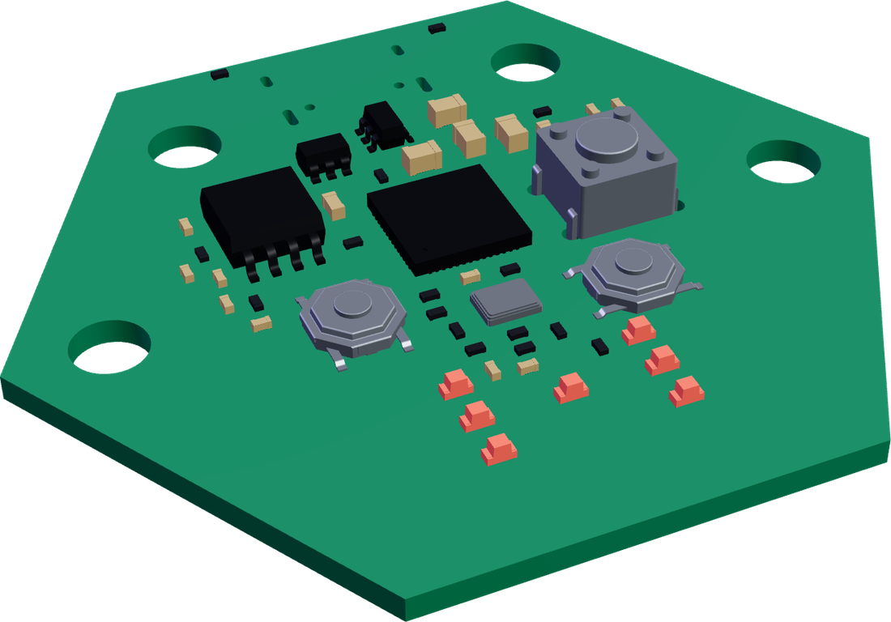</p>

This is a render of [`leanvsdfm/out3d/sierrathon.step`](leanvsdfm/out3d), the STEP file **KiCad exported from our placed board**, with KiCad's own 3D part models and the manufacturer's model for the flash chip. Nothing in it is drawn by hand.

- **54 parts** placed in a 52 × 45 mm hexagon, zero courtyard overlaps, the four M4 holes included.
- **49 measured bodies.** OpenCascade measures each 3D model; Lean places it from the footprint's position and rotation.
- **Lean and KiCad agree.** KiCad's STEP exporter places the same models on its own. The two agree on all 49 body outlines to under 0.05 µm; heights differ by a fixed 50 µm. That comparison is a test (`tools/check_step_agreement.py`), not a proof.
- **The real stack-up is in the KiCad file:** 59.496 mil, layer by layer, from the Sierrathon drawing.

<p align="center">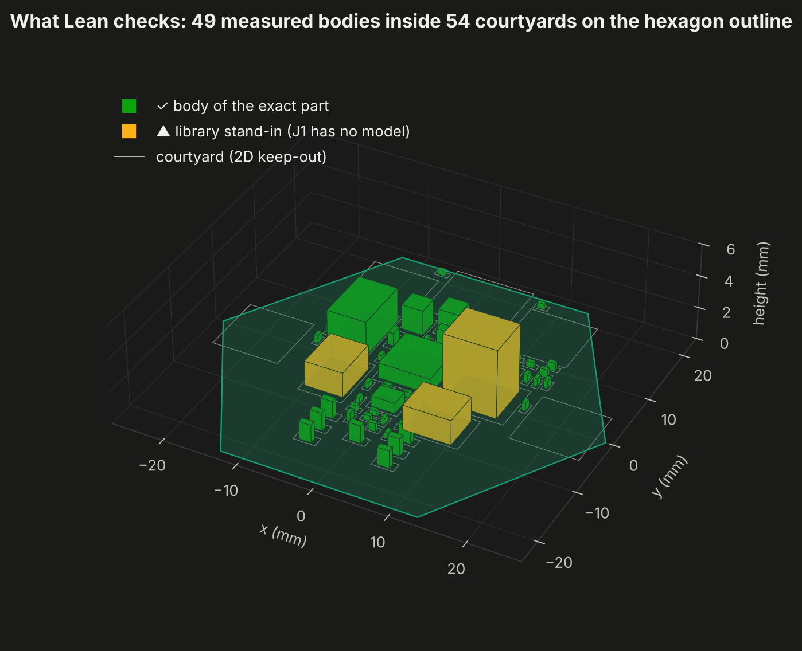</p>

## How it works

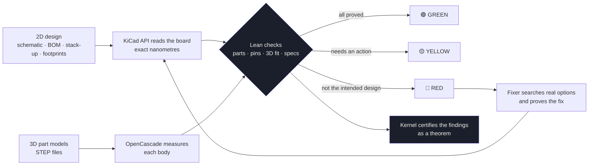

The heart of the 3D check is one theorem, proved once for every possible board ([`Fit3D.lean`](leanvsdfm/LeanVsDFM/Fit3D.lean)):

```lean
/-- If the checker accepts a board, no two part bodies overlap. -/
theorem bodies_never_collide (ps : List Part) (h : fitOk ps = true) : ps.Pairwise bodySep
```

and then applied to our board, where the kernel checks the hypothesis ([`Verify.lean`](leanvsdfm/LeanVsDFM/Verify.lean)):

```lean
theorem our_board_fits : Fit3D.fit3d PcbData.outline PcbData.parts = [] := by decide +kernel

theorem our_board_bodies_never_collide : PcbData.parts.Pairwise Fit3D.bodySep :=
  Fit3D.bodies_never_collide _ (by decide +kernel)
```

`leancheck` does the same for any board you give it: it writes `theorem certified : verify board = [the findings]` and asks the kernel. If the kernel says no, the report says **not certified**.

### Lean and DFM look at different things

| | A DFM check | Lean, here |
|---|---|---|
| Looks at | Fabrication geometry: trace width and spacing, drills, annular rings, solder mask | Intent: the schematic, the BOM, the part numbers, the measured bodies |
| A footprint for the wrong part, with clean geometry | passes | 🔴 wrong package |
| A reversed LED | passes | 🔴 polarity and wrong net |
| The mandated 5/4 mil USB pairs under one global 6 mil rule | flags them | 🟢 knows which nets are impedance nets |
| Result | a list of warnings | a theorem the kernel has checked |

We did not run a commercial DFM tool on this board (it is not routed yet); this table compares what each kind of check examines.

## Demo boards

Five real KiCad files in [`leanvsdfm/pcb/`](leanvsdfm/pcb): our board, and the same board with one realistic mistake each. Every verdict is certified.

| Board | Verdict | What Lean reports |
|---|---|---|
| `sierrathon.kicad_pcb` (ours) | 🟡 YELLOW | Board and 3D fit proved; 4 parts on library stand-ins, J1 has no 3D model, plus the package issues below |
| `fault_led_reversed` | 🔴 RED | D5 pad 1 on `LED3_A`, schematic says `GND`; cathode not on GND |
| `fault_narrow_flash` | 🔴 RED | U3 is `SOIC-8_3.9x4.9mm`; the W25Q128JVSIQ needs `SOIC-8_5.23x5.23mm` |
| `fault_wrong_cap_size` | 🔴 RED | C4 is 0603 on an 0402 line **and** its courtyard now overlaps its neighbours |
| `fault_flash_pins_swapped` | 🔴 RED | U3 pad 2 on `QSPI_D0`, schematic says `QSPI_D1` (and pad 5 the reverse) |

## AI proposes, Lean decides

Anything may propose a way to build the board: a script, or an AI. Proposers are untrusted. Each proposal becomes a real board file with the footprints swapped in place, and Lean rates it. **51 builds, all certified: 16 yellow, 35 red.**

These six were written by Claude, with a reason for each, before Lean rated them ([`explore/ai_proposals.json`](leanvsdfm/explore/ai_proposals.json)):

| AI proposal | Its reasoning | Lean | Why |
|---|---|---|---|
| Keep it nominal | IPC-nominal land patterns everywhere and the manufacturer pattern for the flash: the safest choice for reflow assembly. | 🟡 YELLOW | same as our build |
| Thermal vias under the rp2040 | Use KiCad's thermal-via QFN footprint so the exposed pad can dump heat into the inner planes. | 🔴 RED | the footprint's 0.2 mm vias are below the 8 mil minimum drill |
| Hand-solder the big passives | The 0603 and 0805 parts are the ones a person would rework by hand, so give only those the longer hand-solder pads. | 🟡 YELLOW | fits; reported as variant land patterns |
| Wider soic for the flash | KiCad's 5.275 mm SOIC-8 footprint also targets 208 mil bodies and has slightly longer pads. | 🟡 YELLOW | fits; reported as a variant land pattern |
| Hand-solder the crystal | The 3225 crystal has pads under the body; the hand-solder footprint exposes them for an iron. | 🔴 RED | its larger courtyard overlaps R7, R13, R14 and R17 |
| Hand-solder leds and regulator | LEDs are polarised and often replaced, and the regulator is the hottest part; longer pads make both easier to rework. | 🟡 YELLOW | fits; reported as variant land patterns |

Two plausible ideas were wrong, and Lean said exactly why.

<p align="center">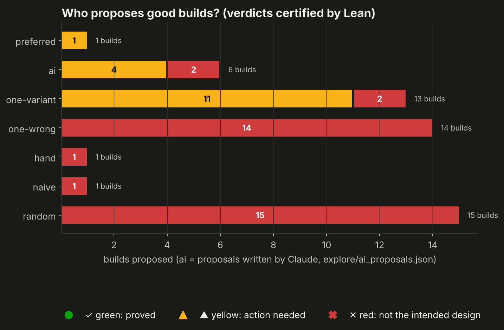 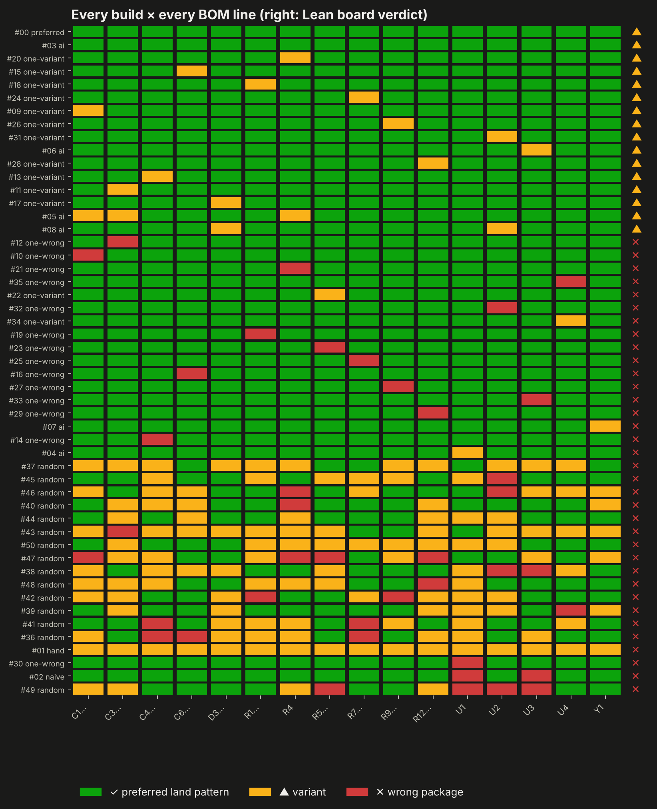</p>

Changing **one** BOM line to its hand-solder variant stays yellow for most lines, but turns red for the 27 Ω USB resistors, the ESD chip and the crystal, because their larger courtyards collide on this compact board.

## Where the supplied package breaks

Four problems in the official Sierrathon files, marked on the files themselves. Each is a Lean theorem in [`Breaks.lean`](leanvsdfm/LeanVsDFM/Breaks.lean).

<p align="center">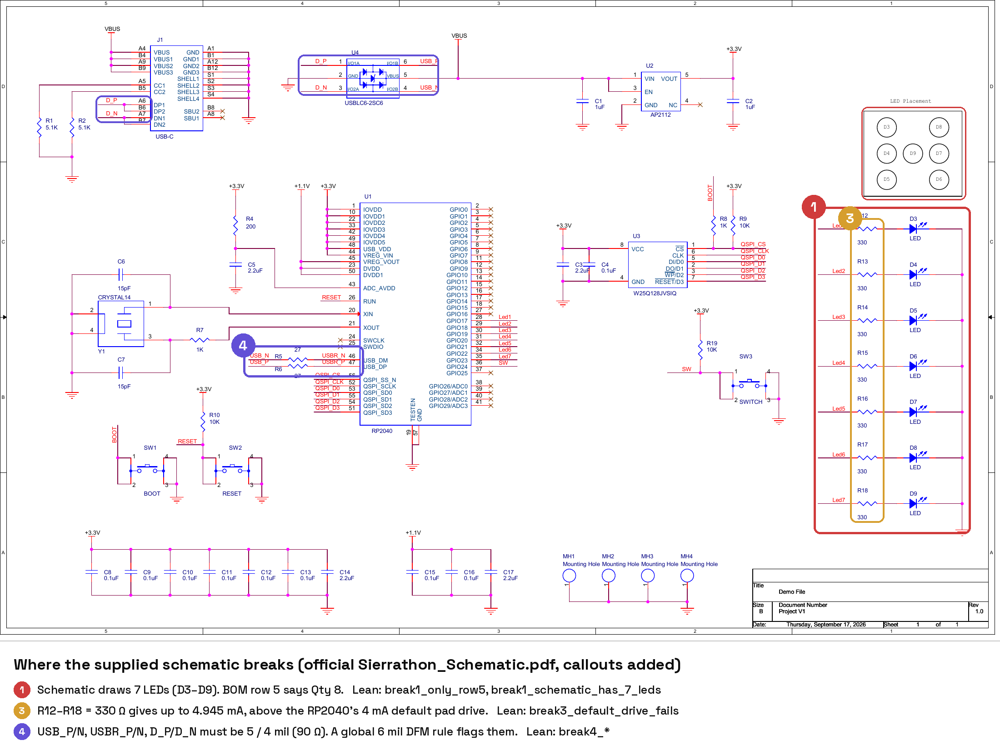</p>
<p align="center">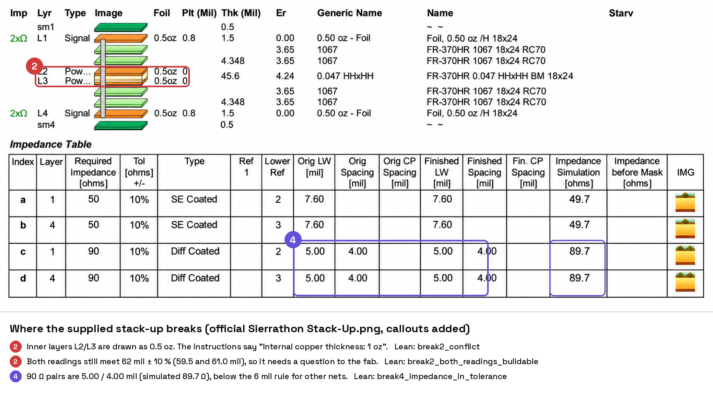 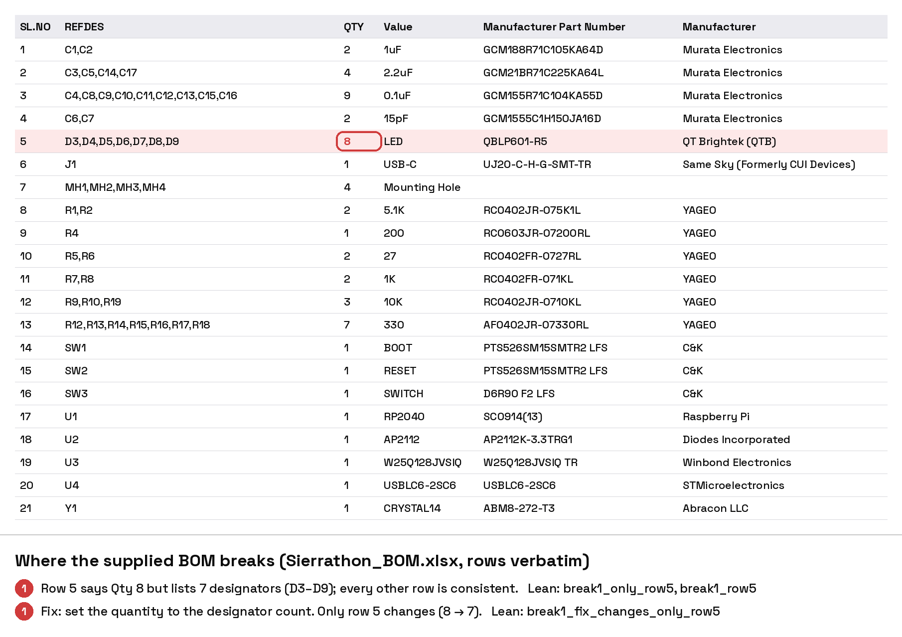</p>

| # | Break | Lean catches it | Fix |
|---|---|---|---|
| 1 | BOM row 5 says **Qty 8**, lists **7** designators; the schematic draws 7 LEDs | `break1_only_row5`, `break1_schematic_has_7_leds` | set quantity to the designator count; only row 5 changes (`break1_fix_changes_only_row5`) |
| 2 | Stack-up draws **0.5 oz** inner copper; instructions say **1 oz** | `break2_conflict` | ask the fab; both readings meet 62 mil ± 10 % (`break2_both_readings_buildable`) |
| 3 | 330 Ω LEDs draw up to **4.945 mA**, above the RP2040's 4 mA default pin drive | `break3_default_drive_fails` | set GPIO17–23 to 8 mA (`break3_fixed_by_8mA`); BOM unchanged |
| 4 | The mandated **5/4 mil** 90 Ω pairs fail a global **6 mil** rule | `break4_dfm_flags_mandated_geometry` | rule per net class (`break4_lean_accepts_pairs`, `break4_lean_still_enforces_6mil`) |

## The proofs, as formulas

Each formula is a theorem the Lean kernel has checked.

**No two bodies overlap** (`Fit3D.bodies_never_collide`, with `Fit3D.sep_of_inside`):

$$\text{fitOk}(ps)\ \Longrightarrow\ \forall\, p \neq q:\ \text{body}(p)\cap\text{body}(q)=\varnothing \qquad\qquad a\subseteq A,\ b\subseteq B,\ A\cap B=\varnothing\ \Longrightarrow\ a\cap b=\varnothing$$

**Where a 3D body lands on the board** (`Fit3D.bodyBox`), with θ a right angle:

$$\binom{x}{y}_{\text{board}}=\binom{p_x}{p_y}+R_\theta\binom{m_x}{-m_y}$$

**Inside the convex board outline** (`Fit3D.pointIn`): the cross product has one sign for every edge (a, b):

$$(b-a)\times(c-a)\ \ge 0$$

**Stack-up thickness** (`Specs.stackup_within_tolerance`):

$$0.5+1.5+4.348+0.6+45.6+0.6+4.348+1.5+0.5 = 59.496\ \text{mil} \in 62 \pm 10\%$$

**LED current** (`Breaks.break3_default_drive_fails`, `Fixers.led_design`):

$$I_{\max}=\frac{V_{DD,\max}-V_{f,\min}}{0.95\,R}=\frac{3.35-1.8}{313.5\ \Omega}=4.945\ \text{mA} > 4\ \text{mA}, \qquad 7\,I_{\max} = 34.6\ \text{mA} \le 50\ \text{mA}$$

**Regulator junction temperature** (`Specs.ldo_junction_ok`):

$$T_j = T_a + \theta_{JA}\,(V_{BUS,\max}-V_{out,\min})\,I = 50 + 250\cdot 2.0\cdot 0.112 = 106^\circ\text{C} < 125^\circ\text{C}$$

**Crystal load** (`Specs.crystal_load_window`), for every stray capacitance from 2 to 5 pF:

$$C_L=\frac{C_6C_7}{C_6+C_7}+C_s = 7.5 + C_s \in [9.5,\ 12.5]\ \text{pF}$$

**ADC supply filter** (`Specs.adc_filter_corner`), for every in-tolerance R and C and every π between 3.141 and 3.142:

$$313 \le \frac{1}{2\pi RC} \le 424\ \text{Hz}$$

**Differential impedance in tolerance** (`Breaks.break4_impedance_in_tolerance`), **BOM self-consistency** (`Breaks.break1_only_row5`), **fixers are correct** (`Fixers.find?_sound`), **overall colour is the worst row** (`Report.overall_is_worst`):

$$0.9\cdot 90 \le 89.7 \le 1.1\cdot 90\ \Omega \qquad \lbrace r : \text{qty}(r)\ne \text{count}(r)\rbrace=\lbrace 5\rbrace \qquad \text{find?}\ p\ l=\text{some}\ a \Rightarrow p(a)\wedge a\in l \qquad \forall r:\ \text{rank}(r)\le\text{rank}(\text{overall})$$

The [theorem table](docs/THEOREMS.md) covers 98 theorems across seven modules, including the web checker. The proofs use Lean's three standard axioms.

<p align="center">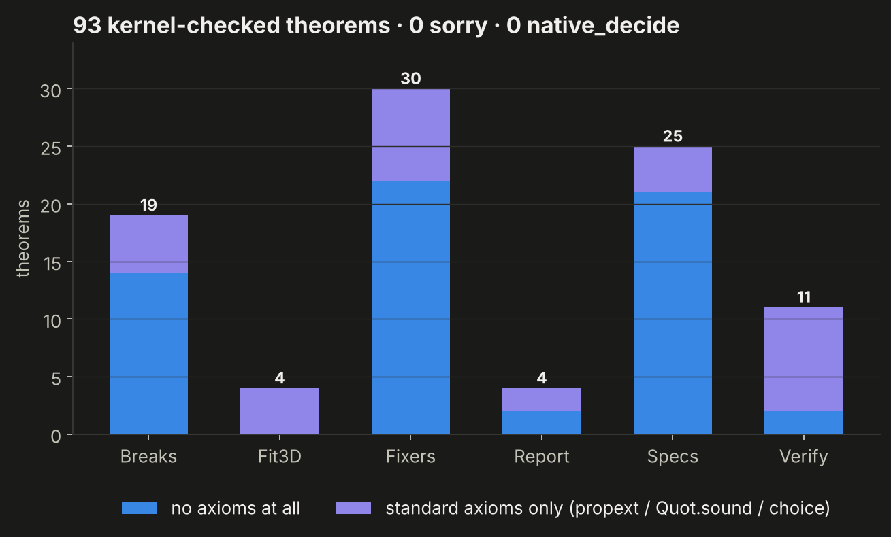</p>

## Figures

| | |
|---|---|
| 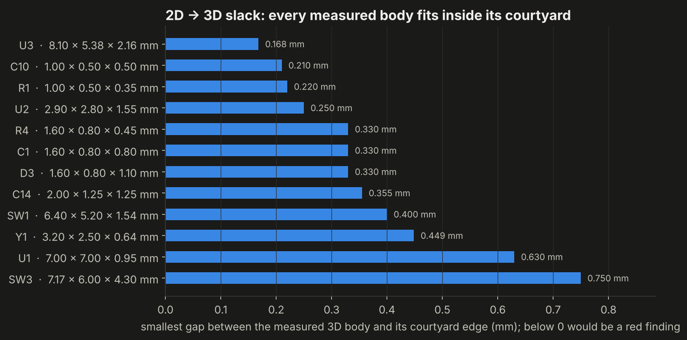 | 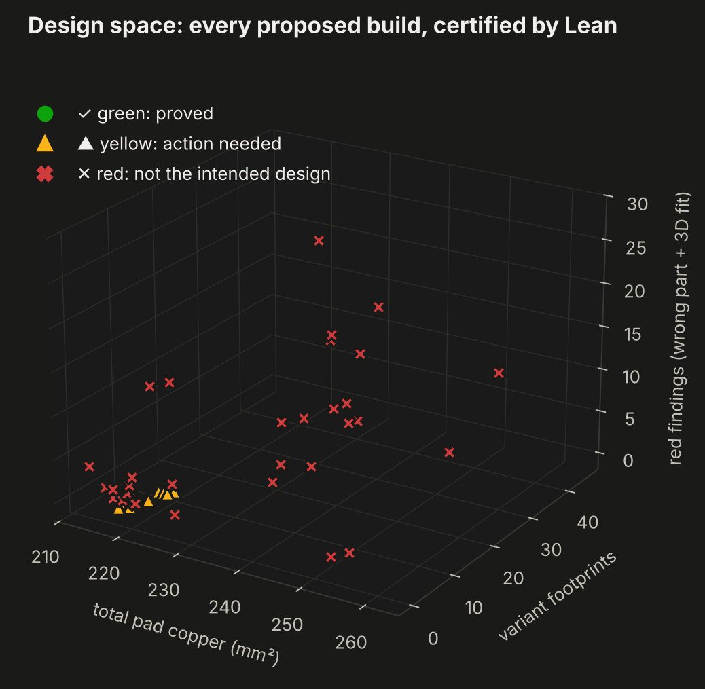 |
| 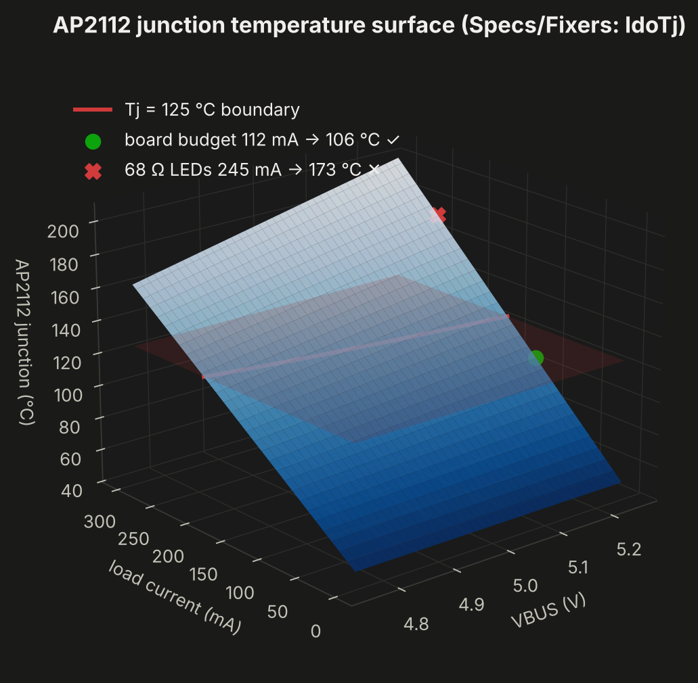 | 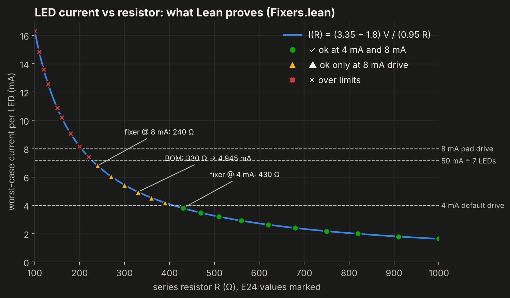 |
| 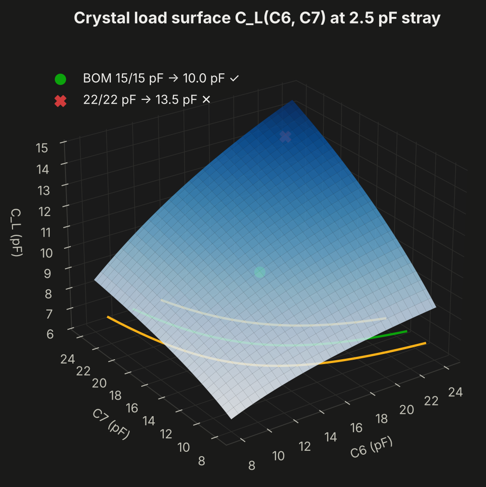 | 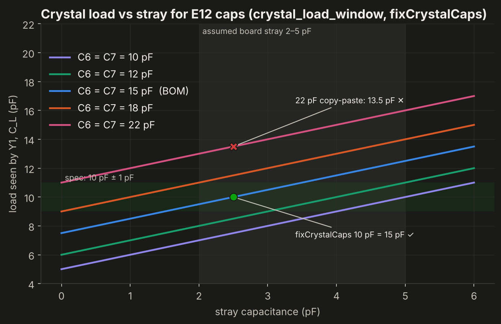 |
| 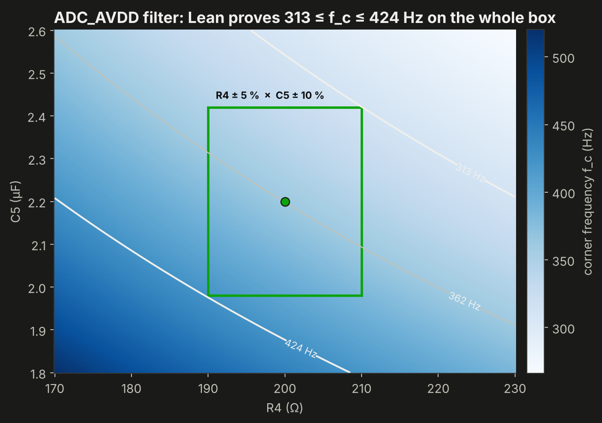 | 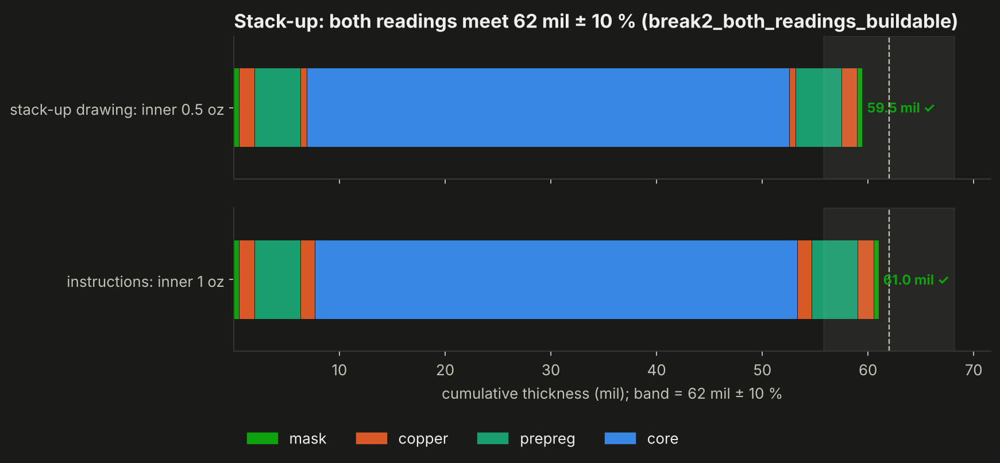 |

Every figure is drawn from real data: the certified runs, the KiCad board, or the exact functions proved in Lean (`leanvsdfm/tools/viz.py`).

## With Claude Code

The repository ships slash commands and a skill ([`.claude/`](.claude)), so you can ask in plain words.

| Command | What it does |
|---|---|
| `/leancheck [board]` | Verdict for a board, row by row |
| `/explore [n]` | Propose n builds and let Lean rate them |
| `/verify` | Rebuild every proof and audit the axioms |
| `/board3d` | Export STEP and test it against Lean's placement |

A real exchange from building this project:

```
You:    Does Lean's idea of where the parts are in 3D match KiCad's STEP export?
Claude: $ python3 tools/check_step_agreement.py out3d/sierrathon_parts.json
        49 Lean bodies vs 49 bodies in KiCad's STEP export: largest outline (x, y)
        difference 0.0 µm, largest height difference 50 µm -> PASS
```

## Run it locally

You need Lean 4 (through elan) and KiCad 7 with its Python module. On Windows, use WSL with Ubuntu 24.04.

```bash
sudo apt install kicad kicad-footprints
```

```bash
curl -sSf https://raw.githubusercontent.com/leanprover/elan/master/elan-init.sh | sh
```

```bash
cd leanvsdfm && lake build
```

```bash
python3 tools/leancheck.py pcb/sierrathon.kicad_pcb --html report.html
```

`lake build` checks every proof. In text and JSON modes, `leancheck` exits 0 for certified green or yellow, 3 for red, and 4 if certification fails. The web API returns a red report with HTTP 422. Yellow findings are accepted design warnings and still require review.

From the repository root, run the fabrication gate separately with KiCad 9.

```bash
python3 leanvsdfm/tools/check_drc.py leanvsdfm/pcb/sierrathon.kicad_pcb --report /tmp/sierrathon-drc.json
```

This command exits 3 for DRC errors or unconnected items, 0 when only warnings or no findings remain, and 2 if DRC cannot run.

Check the exported component solids with OpenCascade using the `OCP` Python module.

```bash
python3 leanvsdfm/tools/check_step_collisions.py leanvsdfm/out3d/sierrathon.step --expected-components 49
```

The check uses OpenCascade solid intersections for candidate pairs. Shared volume above `1e-9 mm³` blocks the check. The expected count covers the modeled components in the current export and excludes the PCB substrate.

For live proposals on Vercel, set `ANTHROPIC_API_KEY` as a sensitive server-side variable for the project's Production environment, then redeploy. If the Anthropic project requires a different model, set `LEANCHIP_MODEL` to a model ID available to that project.

## Repository

```
├── leanvsdfm/               the project
│   ├── LeanVsDFM/           Lean: PartsVerifier · Fit3D · Breaks · Fixers · Specs · Report · Verify
│   ├── tools/               leancheck, board builder and placer, STEP tools, explorer, figures
│   ├── pcb/                 our board and four fault boards (KiCad 7)
│   ├── out3d/               the STEP and GLB that KiCad and OpenCascade produced
│   ├── models3d/            the 3D part models used, with their measured sizes
│   ├── explore/             51 rated builds, including the AI proposals
│   └── reports/             HTML reports
├── netlist/                 the schematic as a netlist (transcribed from the PDF)
├── altium/                  Altium symbol and footprint libraries
├── site/                    the website
├── assets/                  banner, figures, the marked-up Sierrathon files
├── .claude/                 Claude Code commands and skill
└── archive/                 earlier directions, kept for history
```

## What this does not do yet

- **Fabrication is blocked.** KiCad 9.0.2 DRC reports 124 unconnected items and 79 silkscreen warnings on the supplied board. Routing and a fabrication-ready DFM review remain open.
- **Four parts use library stand-ins** (USB-C J1, switches SW1 to SW3). Their manufacturer footprints and 3D models are needed; the report keeps them yellow until then.
- **3D fit has two checks.** Lean proves separation for the measured bounding boxes. OpenCascade checks shared solid volume directly in the STEP export. The current export covers 49 component bodies and is missing J1.
- **Schematic provenance.** `python3 netlist/build_netlist.py --check` verifies the supplied PDF and BOM hashes and reproduces the 39-net transcription. Comparing connectivity directly with the schematic requires the native EDA design or its exported netlist.
- **Electrical inputs.** Raspberry Pi's SDK confirms the 4 mA reset setting and the nominal 2, 4, 8 and 12 mA pad-drive options. The thermal resistance, ambient temperature, load budget, LED forward voltage and stray capacitance still need design-specific validation. [RP2040 pad registers](https://github.com/raspberrypi/pico-sdk/blob/2.2.0/src/rp2040/hardware_regs/include/hardware/regs/pads_bank0.h)
